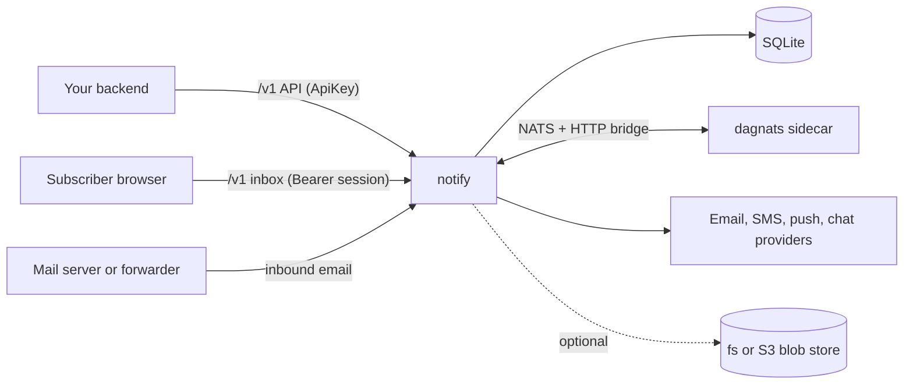

notify is a self-hosted notification and durable-communications engine. You describe what should happen as a workflow, send it an event, and notify runs the steps: it renders templates, respects subscriber preferences, delivers through email, SMS, push, chat and in-app channels, waits, batches, and calls your HTTP endpoints. It also hosts a subscriber inbox, conversations with agents, and a reply loop for inbound email.

This documentation describes release . Everything here was written from the source; where behaviour depends on a default or a limit, the page gives the value.

## How it fits together

notify is one Go binary. It keeps its state in a SQLite file and runs workflows on a **dagnats sidecar**, a separate process that provides the durable workflow engine, an embedded NATS server with JetStream, and an HTTP worker bridge. notify connects to the sidecar on start; it never starts it.

## Where to go next


  
  
  
  
  
  

